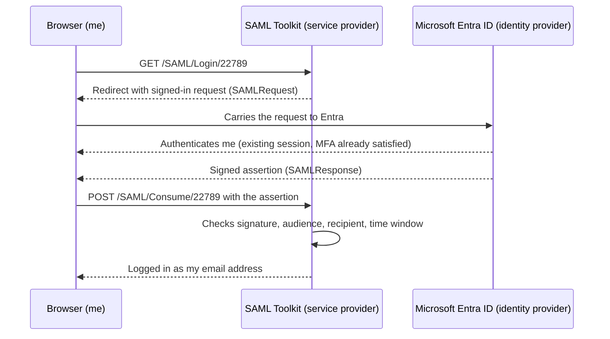

# Entra-SAML-Lab

Microsoft Entra ID as a **SAML 2.0 identity provider**, signing a user into a separate service provider. I captured the real assertion off the wire, decoded it, and checked its signature.

This is the SAML counterpart to my [Okta OIDC lab](https://github.com/rogersombe/Okta-Oidc-Lab). Same question, older protocol: how does one system convince another that a user is who they say they are, without the second system ever seeing a password?

**Date built:** 26-27 October 2026 | **Time taken:** about 4 hours | **Cost:** nothing

---

## The flow I built

The browser is the courier in the middle. Neither side talks to the other directly, which is why the signature matters so much. The courier could be lying.

## Configuration

| Setting | Value |
|---|---|
| Identity provider | Microsoft Entra ID (my lab tenant) |
| Service provider | Microsoft Entra SAML Toolkit (gallery app) |
| Entity ID / Audience | `https://samltoolkit.azurewebsites.net` |
| Reply URL (ACS) | `https://samltoolkit.azurewebsites.net/SAML/Consume/22789` |
| Sign-on URL | `https://samltoolkit.azurewebsites.net/SAML/Login/22789` |
| NameID format | `emailAddress`, sourced from `user.mail` |
| Signing | RSA-SHA256, SHA-256 digest, over the Assertion |
| Trust anchor | Entra's signing certificate, uploaded to the SP as a raw `.cer` |

## Two things that bit me

**1. The configuration has a chicken-and-egg order.** Entra greys out the certificate download until the required fields in Basic SAML Configuration are saved. But the real values for those fields come from the service provider, which in turn wants Entra's certificate and URLs first. The way through: save placeholder values, download the certificate, register the SP configuration, then come back and replace the placeholders with the SP's numbered URLs. Entra also issued a fresh signing certificate when I first saved, so the certificate has to be downloaded *after* that save.

**2. My identity looked wrong on the wire.** My account is a Microsoft personal account invited into the tenant as a guest, so its user principal name is `…_gmail.com#EXT#@<tenant>.onmicrosoft.com`. By default, Entra sends the UPN as the NameID. The toolkit requires an email-format NameID, and the Email property on my user object was empty, so simply switching the claim to `user.mail` would have sent a blank. The fix was two parts: populate the Email property on the user, then change **Unique User Identifier (Name ID)** to format *Email address* with source attribute `user.mail`. The `#EXT#` name still travels as a separate `name` attribute, which makes a handy before-and-after.

## Reading the assertion

I recorded the login in Chrome DevTools (Network tab, *Keep log* on), found the `POST` to the ACS URL, and pulled the base64 `SAMLResponse` out of the form data. Decoded:

| Element | Value (identifiers shortened) | What it does |
|---|---|---|
| `Issuer` | `https://sts.windows.net/328c54d5-…/` | Names the tenant vouching for me |
| `Destination` / `Recipient` | `…/SAML/Consume/22789` | The one address this may be delivered to |
| `InResponseTo` | `uuid-3AA7CB94-…` | Binds the answer to the request the SP made, so a stale answer can't be replayed into a new login |
| `Audience` | `https://samltoolkit.azurewebsites.net` | Who the assertion is for. An SP should refuse it if this isn't its own ID |
| `NameID` | my email, format `emailAddress` | Who I am, as far as the SP is concerned |
| `Conditions` | `NotBefore 22:30:14Z`, `NotOnOrAfter 23:35:14Z` | The validity window, about 65 minutes (five minutes of clock-skew allowance before, an hour after) |
| `Signature` | RSA-SHA256 over the `Assertion`, enveloped, exclusive c14n | The tamper seal |
| Embedded certificate | `CN=Microsoft Azure Federated SSO Certificate`, valid to 2029-10-26, SHA-1 thumbprint `3569B528F9A12B46035C3CE5C3E2FFD097C7B481` | Public half of the signing key |
| `identityprovider` | `live.com` | Confirms I'm a Microsoft personal account in the tenant |
| `authnmethodsreferences` | `password`, `multipleauthn` | A second factor was used |
| `AuthnInstant` | `21:25:29Z`, an hour before this login | I wasn't challenged again. Entra reused my session, which is single sign-on doing its job |

Attributes sent: `tenantid`, `objectidentifier`, `displayname`, `givenname`, `surname`, `emailaddress`, and `name` (the `#EXT#` UPN).

Worth noting: the **Assertion** is signed, but the surrounding **Response** is not. That is how Entra behaves by default, and it means a service provider has to validate the assertion's signature specifically, not just look for a signature somewhere in the message.

## What I verified

- Decoded the base64 and re-canonicalised the Assertion (exclusive c14n with the enveloped signature removed). The SHA-256 digest I computed matches the `DigestValue` in the message.
- Verified the RSA-SHA256 signature over `SignedInfo` using the certificate embedded in the message. It verifies.
- `Audience` equals the SP's Entity ID, and `Recipient` / `Destination` equal the numbered ACS URL.

**A limit on that last point.** Verifying against the certificate *inside* the message only proves nobody altered it after signing. It says nothing about who signed it. The real trust comes from the SP holding its own copy of Entra's certificate, which is what the upload step does. A service provider that trusts whatever certificate arrives with the message has no authentication at all.

## Breaking it on purpose

Method: change one thing, run the login, read what fails and where, then undo the change and rerun as a control. A failure without a control is an anecdote.

### Break 1: the Identifier no longer matches the SP's Entity ID

| | |
|---|---|
| **Change** | Entra Identifier set to `https://samltoolkit.azurewebsites.net/broken` |
| **Result** | Login stopped on Microsoft's sign-in page: `AADSTS650056: Misconfigured application`. No assertion was issued |
| **Which side** | Entra (the identity provider) |
| **Trace** | The Request ID on the error page matched a row in the tenant-wide sign-in log |
| **Control** | Identifier restored, login rerun: two Success rows in the sign-in log |

Two things worth knowing:

- The error text is a menu of four suspects (permissions, consent, the application identifier, the certificate) with literal `{name}` and `{id}` placeholders left in it. Only one applied. The message alone doesn't tell you which.
- The failure did **not** appear in my app's own sign-in log. It was logged against **Azure AD SAML Toolkit** (Microsoft's template app, ID `229946b9-…`), with a service principal ID of all zeros. That is consistent with Entra matching the request to the global template app because no app in my tenant held that identifier any more. If you only look at the failing app's log, you won't find the failure.

### Break 2: signing certificate rotated, service provider not updated

| | |
|---|---|
| **Change** | Generated a second signing certificate in Entra and made it active (thumbprint `EBD75D17…25B9`). The toolkit still trusted the original (`3569B528…B481`) |
| **Result** | Entra issued a signed response. The toolkit answered the `POST` with status **200** and a generic page: *"An error occurred while processing your request."* A successful login returns **302**. I was left logged out |
| **Which side** | The service provider. No error code, no hint |
| **Cause, shown by capture** | I captured the `SAMLResponse` and decoded it. Digest and signature were valid against the embedded certificate. Audience, Recipient, NameID and time window were all valid. The one difference from the successful run was the signing certificate's thumbprint, which no longer matched the one the toolkit holds |
| **Control** | Original certificate reactivated, login rerun: logged in |

Entra's sign-in log was slow to show this attempt, so I didn't rely on it. The capture is the evidence.

### What the two breaks taught me

- **Where the error appears tells you who to ask.** Identity-provider failures come with a code and a log trail. Service-provider failures can be silent, and the way in is to capture the assertion and compare it against what the SP trusts.
- **Certificate rotation is a quiet way to break SSO.** Nothing in the app's configuration changes, the login fails, and the failure message doesn't name the cause. The old certificate stays in Entra until deleted, which is what makes the rollback one click.
- **Check the failing app's log and the tenant-wide log.** An unmatched request can be filed under a different application name.

## Not done yet

- Reply URL mismatch (Recipient no longer matches the delivery address).
- NameID set back to the UPN, to reproduce the `#EXT#` mismatch.
- A second (unused) signing certificate is still in the tenant from break 2. It is inactive.

## Evidence

Redacted screenshots go in `/evidence`:

- Basic SAML Configuration and Attributes & Claims (including the NameID setting)
- The Network tab showing the `POST` to `/SAML/Consume/22789` (status 302)
- The decoded assertion, with tenant ID, object ID and email redacted
- Break 1: the `AADSTS650056` error page, and the matching sign-in log row (Application: Azure AD SAML Toolkit, status Failure)
- Break 2: the Network tab showing the `POST` to Consume returning `200` (failure) beside the earlier `302` (success), and the signing-certificate panel showing both thumbprints
- Both controls: the restored configuration and the successful login afterwards

## Environment

Microsoft Entra ID lab tenant, Microsoft Entra SAML Toolkit from the Entra application gallery, Chrome DevTools for capture. No code in the deployment, deliberately: the point was to see the protocol's moving parts directly before automating any of it.
